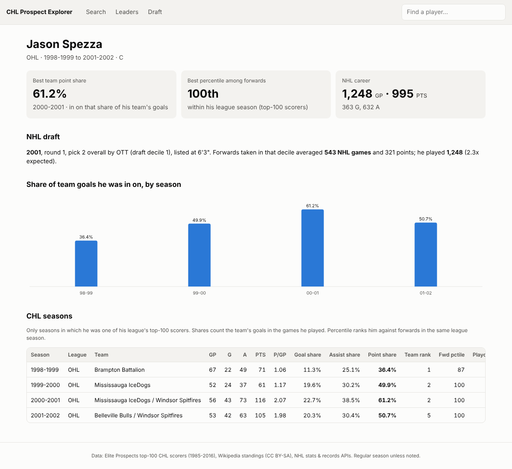
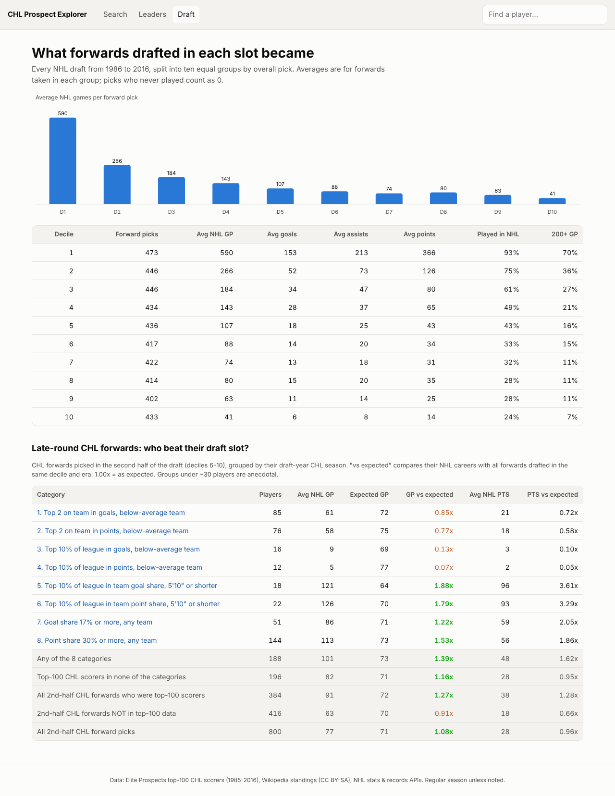

# CHL to NHL: Does Driving Your Team's Offence Predict an NHL Career?

An end-to-end hockey analytics project: a data pipeline, a PostgreSQL database, statistical
analysis, and a Flask web app, built around one question:

> **Does a CHL forward's share of his team's scoring predict NHL success better than his raw
> point totals - and can it find value late in the NHL draft?**

Raw junior scoring is distorted by era (the late 1980s were far higher-scoring) and by team
quality (the fifth forward on a powerhouse can out-score the best player on a weak team).
This project normalizes for both by measuring each player's **share of his team's goals**,
then compares those numbers with what players went on to do in the NHL.



---

## Key findings (CHL forwards, 1985-86 to 2015-16)

| CHL measure (forwards) | Spearman correlation with NHL games played |
|---|---|
| Points per game | 0.36 |
| Goals per game | 0.36 |
| Team point share (share of team goals he was in on) | 0.34 |
| Team goal share | 0.32 |
| Assists per game | 0.29 |
| Career CHL point totals | 0.22 |

- **Rates beat totals.** Per-game and share-of-team measures predict NHL careers far better than
  career CHL totals, which mostly reflect how long a player stayed in junior.
- **Team share and points per game are close to interchangeable**; the strongest signal is being
  high on both. 41% of forwards in the top 10% of **both** reached 200+ NHL games, against 15% of
  all forwards studied.
- **Goals predict better than assists for forwards.** (An earlier all-position version suggested the
  opposite; that was driven by defencemen, which is why the analysis was restricted to forwards.)
- **Late-round value:** second-half draft picks who were in on 30%+ of their CHL team's goals played
  about **1.5x the NHL games expected** for their draft slot; small (5'10" and under) forwards in the
  top 10% of their league for team point share played about **1.8x** (small sample).
- **Draft slot matters most at the top:** forwards taken in the first 10% of picks averaged 590 NHL
  games; the next 10% averaged 266.

## How it works

```
Elite Prospects top-100 files ─┐
Wikipedia standings ───────────┼─► collect_data.py ─► load_database.py ─► PostgreSQL (chl_stats)
NHL stats API (careers) ───────┤                                              │
NHL records API (draft) ───────┘                       ┌──────────────────────┼─────────────────┐
                                                       ▼                      ▼                 ▼
                                              chl_analysis.py       draft_analysis.py     web/app.py
                                              (Excel reports,       (draft deciles,       (Flask app:
                                               correlation,          late-round            search, player
                                               deciles, charts)      outliers)             pages, leaders)
```

### Data pipeline - `CHL_Data/Python/`

| File | Purpose |
|---|---|
| `collect_data.py` | Downloads CHL standings (Wikipedia API, parsed from 30 years of inconsistent table layouts), NHL careers (NHL stats API) and every draft pick 1986-2016 (NHL records API). Polite, cached and resumable. |
| `load_database.py` | Cleans the Elite Prospects files (traded players, duplicate rows, name collisions), matches team names across sources, links CHL players to NHL players (name + birth-year plausibility + name variants) and draft picks to draft-year seasons. Rebuilds the database in one transaction. |
| `schema.sql` | Normalized schema: leagues, seasons, teams, players, player seasons, team splits, team seasons, NHL players, draft picks, with constraints, indexes and analysis views (team/conference goal shares, games-played adjustment, percentiles). |
| `chl_analysis.py` | Goal-share breakdown, CHL-to-NHL correlation matrix (Spearman/Pearson), AUC for predicting 200+ game careers, and decile analysis. Forwards by default (`--position all` to compare). |
| `draft_analysis.py` | What forwards drafted in each draft decile became, and eight late-round CHL categories compared with draft-slot expectations. |
| `common.py` | Shared paths, database connection, name matching and Excel/chart helpers. |

### Web app - `CHL_Data/web/`

A Flask app with server-rendered pages and vanilla JavaScript (search-as-you-type, sortable tables,
SVG charts with hover tooltips; light and dark themes; works on mobile):

- **Search** any of 4,778 CHL players
- **Player profile:** team share of scoring by season, percentile among forwards, draft slot vs.
  expectation, NHL career
- **Leaders:** top seasons by team point/goal/assist share or points per game, filterable
- **Draft:** outcomes by draft decile and late-round categories, linked to player pages



## Key measures

- **Team point share** = player's points ÷ his team's goals for. A share of 0.30 means he scored or
  assisted on 30% of his team's goals.
- **Games-played adjustment:** team goals are counted only for the games he played
  (team goals per game × his games), so injured and traded players are compared fairly.
- **Percentile:** rank among forwards in the same league and season, which neutralizes era.
- **Expected NHL career for a draft slot:** average career of all forwards drafted in the same
  draft decile and era, counting players who never played as 0.

## Running it

Requires Python 3.11+ and PostgreSQL.

```bash
cd CHL_Data/Python
python -m pip install -r requirements.txt
python collect_data.py        # standings, NHL careers, draft picks
python load_database.py       # builds the chl_stats database (asks for the PostgreSQL password)
python chl_analysis.py        # reports in CHL_Data_Full/Analysis
python draft_analysis.py
cd ../web
python app.py                 # opens http://127.0.0.1:5000
```

The CHL player files (each league's top-100 scorers per season, regular season and playoffs) come from
[Elite Prospects](https://www.eliteprospects.com) and are **not included** in this repository. Place
them in `CHL_Data/WHL`, `CHL_Data/OHL` and `CHL_Data/QMJHL`, named like
`2000-2001 OHL Player Stats Regular Season.xlsx`.

## Limitations

- **Top-100 scorers only.** The CHL files list each league's top 100 scorers per season, so most
  defencemen and lower scorers are missing, and percentiles are relative to other top-100 scorers.
- **Regular season only** for team shares: no free source lists team playoff goal totals.
- **No ages for players who never reached the NHL**, so the analysis can't fully adjust for age -
  a 20-year-old's share is less impressive than a 17-year-old's. Age adjustment is the clearest next step.
- **Name-based matching** between sources; a small number of links may be wrong.
- **Recent draft classes** (2013-2016) are still adding NHL games.
- A few Wikipedia seasons have small goals-for vs. goals-against discrepancies (flagged by the pipeline).

## Next steps

- Age-adjust using birth dates from the draft data (available for every drafted player).
- Bring in full rosters to remove the top-100 limitation.
- A separate model for defencemen using ice time and defensive measures.

## Sources

- CHL player statistics: Elite Prospects (top-100 scoring exports)
- CHL standings: Wikipedia season pages, via the MediaWiki API (CC BY-SA 4.0)
- NHL careers: NHL stats API (`api.nhle.com`); NHL draft: NHL records API (`records.nhl.com`)

## About this project

Built by Troy Trentham as a portfolio project. The questions, categories and analytical decisions are
my own; I used an AI coding assistant (Claude) to help write and test the code.
